# GitHub Copilot Agentic Harness on VS Code

<p>
  
  
  
  
  
  
</p>

**Make GitHub Copilot carry a task from start to finish the way your team works: it follows the rules, stays inside its boundaries, and leaves a record you can review.**

[Talk to the agent on the board](#talk-to-the-agent-on-the-board) · [What you get](#what-you-get) · [Get started](#get-started) · [See it](#see-it) · [What you must plug in](#what-you-must-plug-in) · [Docs](#docs) · [Release notes](docs/07-release-notes.md)

<p align="center">
  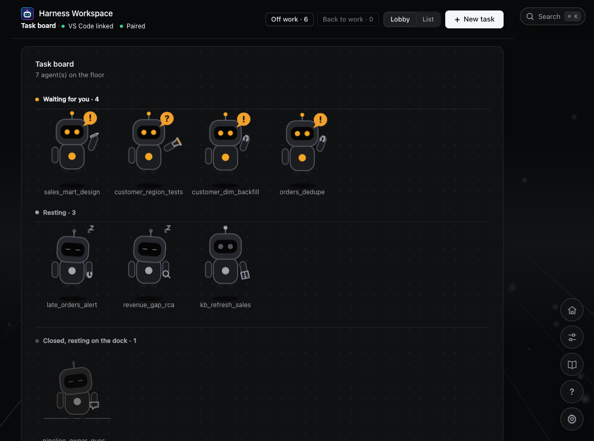
</p>

**New here? Read the [overview](docs/00-overview.md) first**: the problem, the way of working, what you see in the browser, and how it is built, with pictures.

---

## Talk to the agent on the board

**You no longer have to work in the chat window.** The board is linked to VS Code: every task has its chat on the page, and you talk to the agent from there.

<table>
<tr>
<td width="50%"><a href="docs/images/talk-live.png">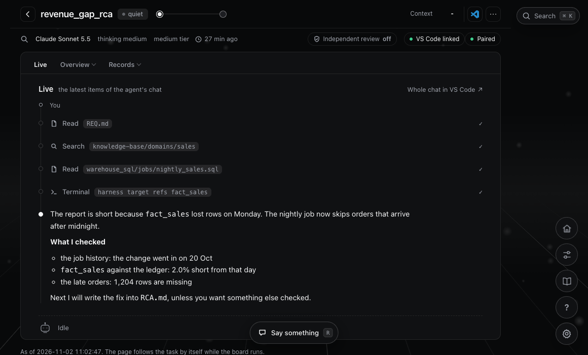</a><br><sub><b>Watch it work.</b> The agent's words, tool calls and times, as they happen.</sub></td>
<td width="50%"><a href="docs/images/talk-to-agent.png">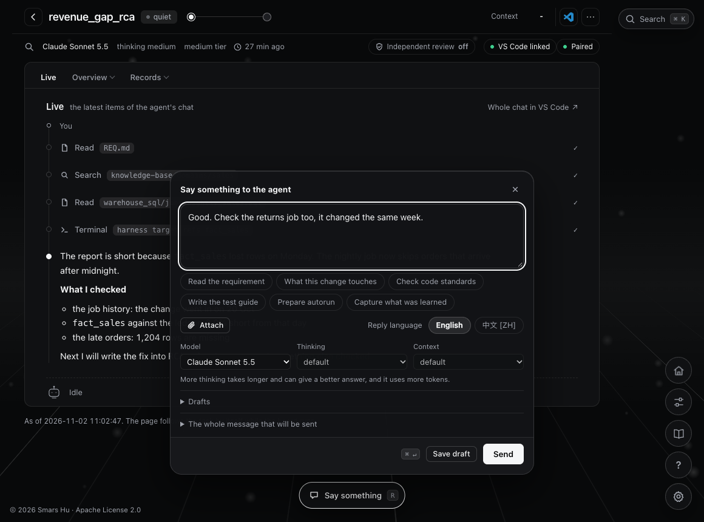</a><br><sub><b>Talk to it.</b> Press <code>R</code> on any tab. Text, files, skills, the model and the thinking level.</sub></td>
</tr>
</table>

- **Start** a task and its chat with **New task**, and see the first message before it is sent.
- **Reply** with text, screenshots and files. While the agent works, your words join the same turn.
- **Stop** it at any time, or **take back** your last message: the agent forgets it.
- **Answer** what it asks, and **allow or deny** a command, without leaving the page.
- **Read back** every earlier prompt and answer, also what the chat window folds away.

The rules still hold: the gate checks every call, and approvals stay yours.

## What you get

- **Set up in the browser.** Double-click **Start Harness** and fill in **Get ready**: the short command, your code repositories, your knowledge base. No agent runs and you edit no file.
- **Led step by step.** **How can I help?** on the board starts the lesson you need, and **Everything you can ask for** lists every skill by what you want to do.
- **A task, not a chat.** Every piece of work is a folder: the requirement, the plan, the steps, the log and the changes are files. A new chat reads `TASK.md` and goes on. Kinds: question, root cause analysis, design, development, testing, knowledge base update.
- **A board you follow in the browser.** Every open task, what it waits for you for, and since when. The lobby shows each one as a small agent: at work, waiting for you, resting. A click opens the task as pages: stages, requirement, plan, TODO, changes, checks, test results, history.
- **A knowledge base you can see.** Lessons lead you through building it from your code. The **Knowledge base** window shows the steps, the domains, how they hang together, and what a change can reach.
- **Approvals only you can give.** The requirement, the plan and the write-back to a repository each wait for a code you type on the page or in your terminal. The agent cannot approve for you, and `push` can never be approved.
- **Business documents in, no tokens spent.** Drop Word or Excel files on the **Intake** tab (old Excel and PDF need one Python package): a program turns them into Markdown and CSV, and reports what it left out (hidden sheets, comments, pictures). You trim them; the agent reads the small files and asks only what does not fit.
- **Independent checks, counted by code.** Write `[review]=2` and the work must pass two checks in a row by a reviewer that never saw the author's reasoning. Every round, its findings and its verdict are on the **Review** tab.
- **Tests that leave evidence.** A test task has one guide with a section per environment (DEV, IST, UAT). You run it, paste the output and screenshots on the page, and the agent judges each criterion against what you brought. Run 1, Run 2: all kept.
- **Safe write-back.** The harness writes only the files to change, to a new branch, uncommitted. It keeps a patch, a snapshot and a restore command.
- **Time and cost in view.** Where the time went (working, waiting for you), every prompt, every tool, the usage Copilot records. Per task, from the hook log, not from the agent's word.
- **Moves with you.** `/harness-reinstall` carries tasks, runtime settings and the knowledge base to a new copy of the harness.

## What it is

Teams that get Copilot often use it only to complete code or change a few lines. There are three reasons:

- **It doesn't know your work.** How tables are named, how a metric is defined, where to look first when a job fails: it knows none of this.
- **It has no workflow.** A task that takes several days is forgotten as soon as you open a new chat.
- **It has no boundaries.** Nobody dares to let it change a repository that feeds production.

This repository is a framework (a harness) that wraps Copilot and fixes the second and third problems. The first is fixed by the knowledge base and skills you plug in.

```text
1. Copilot agent                  thinks and calls tools                    provided by GitHub
2. Knowledge base + domain skills what your work and code look like         you plug these in
3. Harness                        rules, boundaries, checks, observability  this repository
4. Targets                        code repositories, databases and so on    your environment
```

The harness carries no business knowledge. It makes the agent safe to use and possible to manage; the knowledge base and skills make it do the work correctly. See the [overview](docs/00-overview.md).

## Get started

You need VS Code with GitHub Copilot Chat, Python 3.9 or later, and git. Nothing is required to `pip install`: Word and Excel (`.xlsx`) files are read with the standard library. Old Excel (`.xls`) and PDF files need one small package each (`xlrd`, `pypdf`). Get ready has a row for the install command, and if the install fails you ask your administrator: see [Python packages](docs/03-configure.md#python-packages).

Clone this repository, or download the zip from GitHub and extract it (git is optional; on Windows extract to a short path such as `C:\dev\harness`). Open the folder in VS Code. Then:

1. **Start.** Double-click `Start Harness.command` (macOS) or `Start Harness.cmd` (Windows) and keep the window open. If the double-click is blocked, run `sh .harness/bin/harness task board` (Windows: `.harness\bin\harness.cmd task board`) in a terminal.
2. **Set up.** Press **Get ready** on the page that opens. The form sets up the short command `harness`, your code repositories and your knowledge base. No agent runs. To change it later, press the sliders button at the bottom right of the board.
3. **Learn.** Press the question mark at the bottom right of the board, **How can I help?**. Ask how the harness works, or start a lesson; the board opens the chat for you. **Everything you can ask for** lists every skill, with the knowledge base ones in the order you build it.
4. **Build your knowledge base.** Press the book button to see the steps and the next one. The agent leads you, you give a few facts only you know and approve each step.

| Start from the board, or type it in Copilot Chat | What it walks you through |
| --- | --- |
| `/harness-rookie-quick-start` | **Introductory lesson**: a story from a request to a branch, what the harness gives you, the two places you work in (the Chat window and the board), and one practice task. About 20 minutes |
| `/harness-rookie-new-knowledgebase` | **Build your knowledge base from your code**, step by step. Come back any time with "continue the knowledge base" |
| `/harness-rookie-wondering` | **Understand it first**: an interactive explanation of the principles and implementation, 16 topics, ask anything |

You don't need to read the docs first. To do it by hand, see the [quickstart](docs/01-quickstart.md).

To move to a newer copy of the harness later, press **Coming from an older copy?** on Get ready, or type `/harness-reinstall` in the new copy: it carries your tasks, settings and knowledge base over.

After that, daily use takes one sentence: press **New task** on the board, or tell Copilot what you want done. It asks until the request is clear, then opens a task. You don't write long prompts or paths. See [what to say day to day](docs/01-quickstart.md#7-what-to-say-day-to-day).

## What it does

| The problem with Copilot | What the harness does |
| --- | --- |
| **Rules are only requests.** A model can ignore a rule written in a prompt, edit files it shouldn't, and run dangerous commands | **Rules are enforced by code.** A hook checks every tool call before it runs. Out-of-scope writes, changes to `.git` and dangerous commands are rejected |
| **Progress lives only in the chat.** Once the context is compacted or you start a new session, nobody knows where the task stood | **One directory per task.** The requirement, plan, progress and results are files. A new session reads `TASK.md` and continues |
| **It grades its own work.** Ask it to check its own output and it always says everything is fine | **Independent checks, counted by code.** You write `[review]=n` and the result must pass n checks in a row. The reviewer never sees the author's reasoning |
| **Confirmation pop-ups can't be trusted.** One click on "Allow in this Session" and there is no confirmation any more | **A person approves the key actions.** The plan, write-back to a repository and git write commands are confirmed in your own terminal. `push` can never be approved |
| **Changing a company repository is risky.** It may commit or push by mistake | **Safe write-back.** The harness takes only the files to be changed and writes to a new branch without committing. It keeps a patch, a snapshot and a restore command |
| **"Done" comes without evidence.** What changed and who checked it are hard to trace afterwards | **Visible and reviewable.** Every session has a log and every task has a report. `harness task list` shows which tasks are waiting for you |
| **Cost is hard to control.** Small tasks go through the same heavy process | **Saves time and money.** Commands do the deterministic work instead of the model, the agent reads only what it needs, and small tasks skip the heavy process |

There is more: queued write-back when several tasks target the same repository, tasks that update the knowledge base, parallel chunked reading (`/generic-mapreduce`), and autorun, which works through a checklist unattended (beta). See [features](docs/02-features.md) for the full list.

> The gate checks the text of a command. It **prevents mistakes; it does not stop someone who is trying to get around it**. Do not treat it as a sandbox.

## See it

All pictures are from a made-up team's tasks, on the real board.

<table>
<tr>
<td width="50%"><a href="docs/images/enter.png">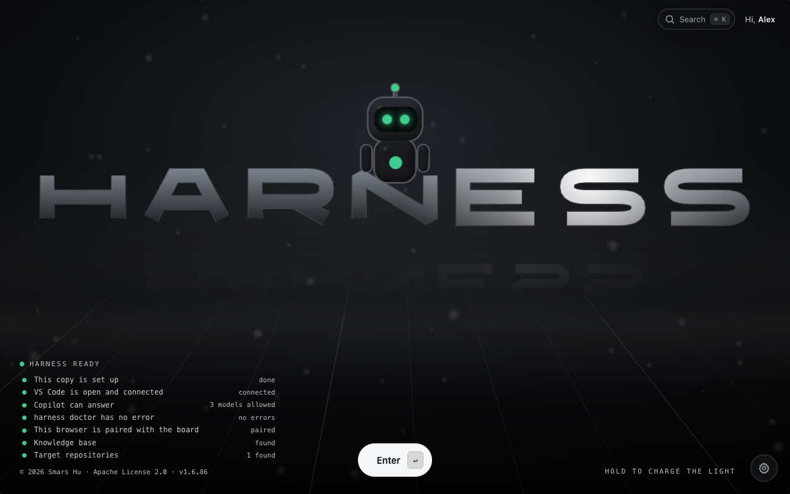</a><br><sub><b>Start.</b> Double-click Start Harness. One line for each thing the harness needs.</sub></td>
<td width="50%"><a href="docs/images/get-ready.png">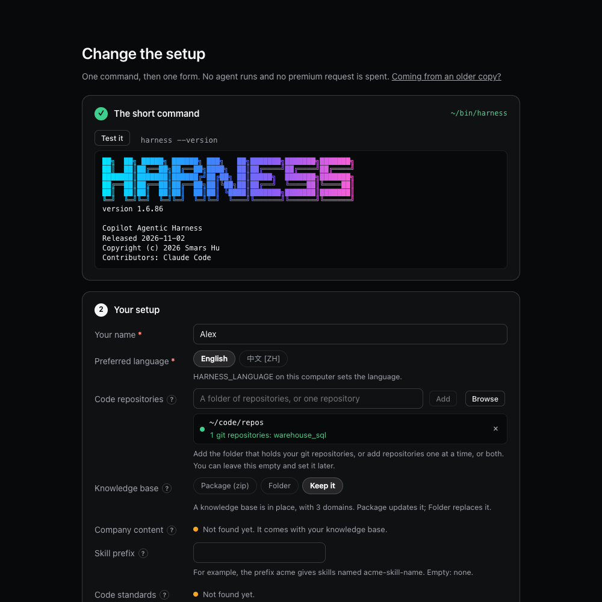</a><br><sub><b>Get ready.</b> Set up in the browser. No agent runs.</sub></td>
</tr>
<tr>
<td width="50%"><a href="docs/images/how-can-i-help.png">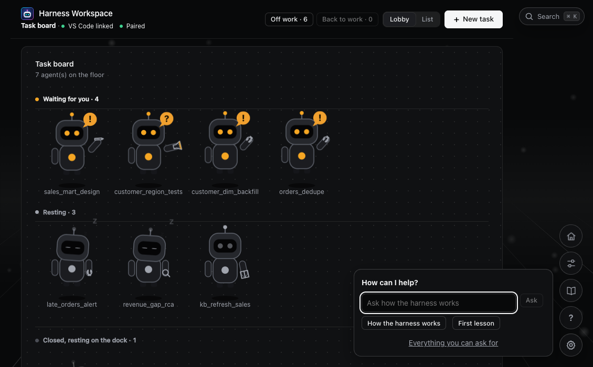</a><br><sub><b>How can I help?</b> Ask, start a lesson, or see every skill.</sub></td>
<td width="50%"><a href="docs/images/kb-overview.png">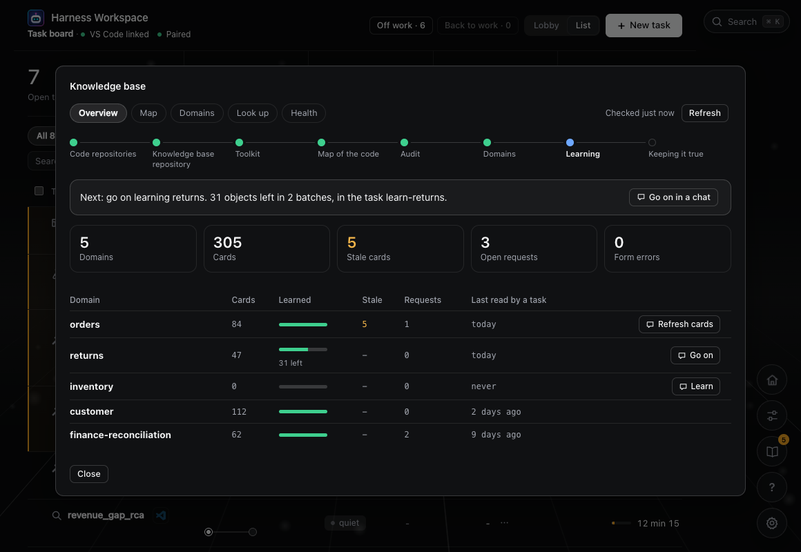</a><br><sub><b>The knowledge base.</b> The steps, the next one, and each domain with its cards. A <a href="docs/images/kb-map.png">map</a> shows how domains hang together.</sub></td>
</tr>
<tr>
<td width="50%"><a href="docs/images/task-overview.png">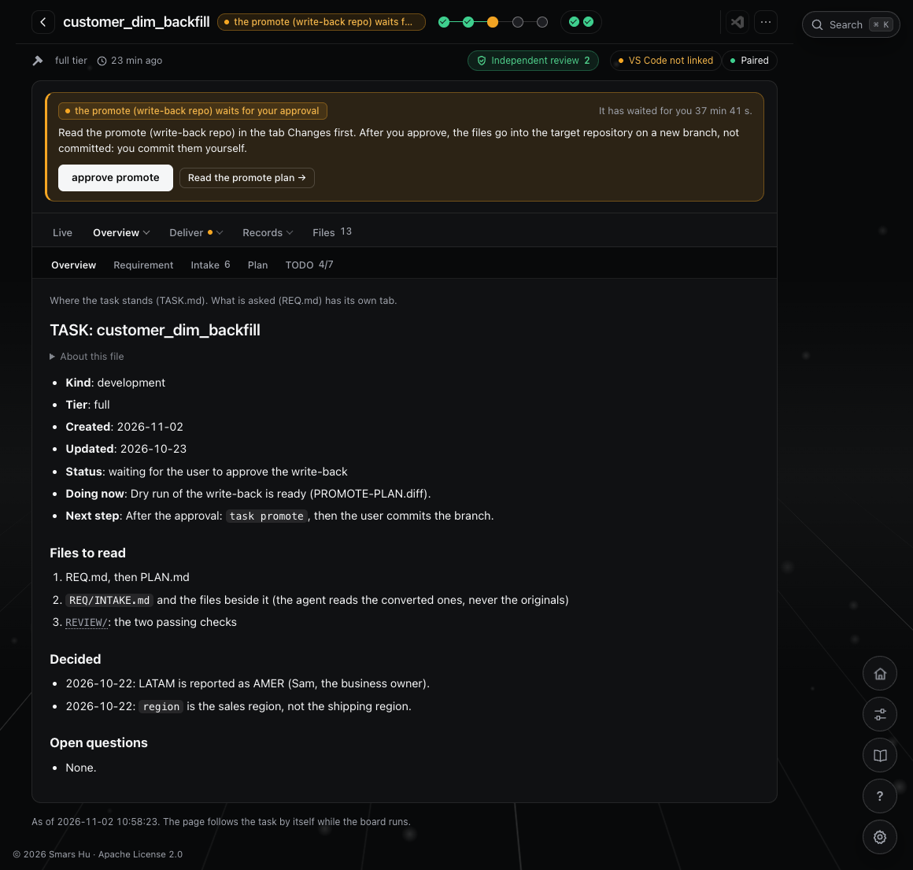</a><br><sub><b>A task page.</b> Stages, the reviewer's checks, and what waits for you with a button for each answer.</sub></td>
<td width="50%"><a href="docs/images/task-intake.png">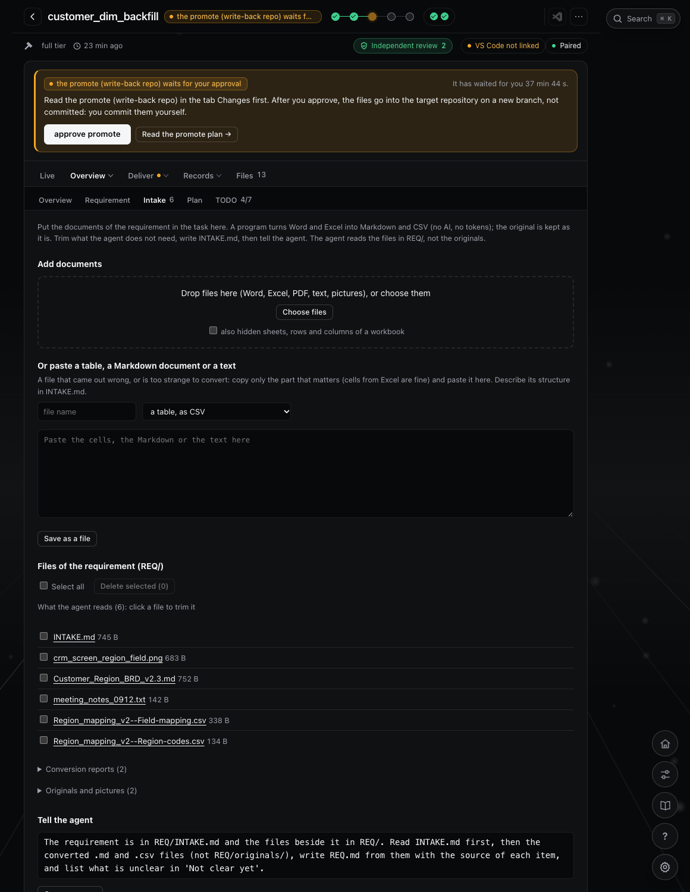</a><br><sub><b>Intake.</b> Drop Word, Excel and PDF files; paste a table; trim, pick and delete files before the agent reads them.</sub></td>
</tr>
<tr>
<td width="50%"><a href="docs/images/task-review.png">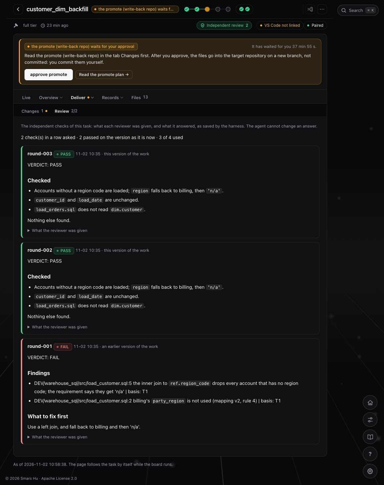</a><br><sub><b>Independent checks.</b> Each round: what the reviewer was given, what it found, its verdict.</sub></td>
<td width="50%"><a href="docs/images/task-test.png">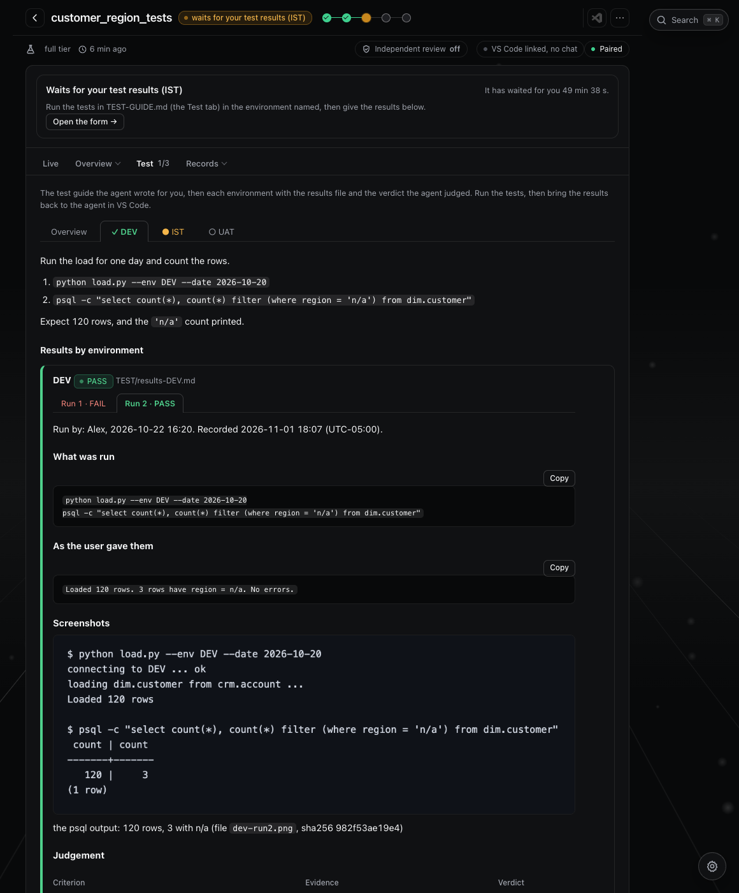</a><br><sub><b>Testing.</b> One sub-tab per environment, each run with its commands, your words, screenshots and the verdict.</sub></td>
</tr>
<tr>
<td width="50%"><a href="docs/images/task-changes.png">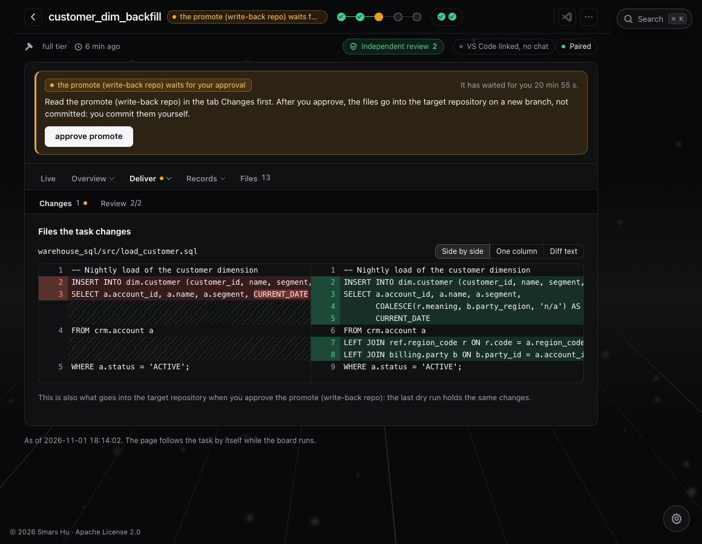</a><br><sub><b>Write-back.</b> The diff, and exactly what goes into the repository when you approve.</sub></td>
<td width="50%"><a href="docs/images/report.png">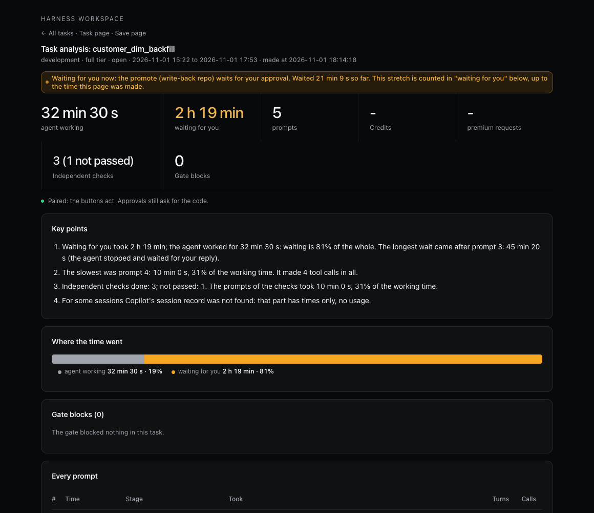</a><br><sub><b>Where the time went.</b> Working and waiting, every prompt, the tools, the checks.</sub></td>
</tr>
</table>

More pictures, in the order of a task's life, are in the [overview](docs/00-overview.md#4-follow-and-steer-it-in-the-browser).

## What you must plug in

The harness is generic and carries no business content. **Without the two items below it cannot do your daily work.** **Get ready** sets up both.

- **Company knowledge base.** Bring it in on Get ready, as a package or a folder, or build one from your code. It goes in `knowledge-base/`, and the **instructions that come with it** go in [.github/instructions/knowledgebase.instructions.md](.github/instructions/knowledgebase.instructions.md). This file ships empty. Without it the agent doesn't know how to read the knowledge base through its index. `doctor` reminds you.
- **Target repositories.** On Get ready, add the folder that holds your code repositories, or single repositories. They go in `target.override.json`. Until this is set, the agent cannot change your code. Once it is set, a target repository can be written only through a promote that you approve.

The harness is designed for the git repositories of data engineering teams: no entry point, cannot be run on a laptop, and a large number of Python, SQL, `.json`, `.sh` and PowerShell files organised by domain. The agent cannot verify its work by running it, so it depends more on the knowledge base. See [configuration](docs/03-configure.md).

## Docs

If you'd rather not read docs, the board and the lessons above are enough.

| Doc | What you will find |
| --- | --- |
| [00 Overview](docs/00-overview.md) | [**Read this first.**](docs/00-overview.md) The problem, the task way of working, the board, the Intake, Test and Review pages in pictures, how it is built, and what is not solved yet |
| [01 Quickstart](docs/01-quickstart.md) | [**Run it by hand.**](docs/01-quickstart.md) Requirements, setting up the `harness` short command, the `doctor` self-check, a first task, and what to say day to day |
| [02 Features](docs/02-features.md) | [**What it can do.**](docs/02-features.md) Tasks, the gate, the two approvals, independent checks with `[review]=n`, logs and reports |
| [03 Configuration](docs/03-configure.md) | [**Plug in your own material.**](docs/03-configure.md) Overrides, target repositories, the knowledge base, domain skills, choosing a model |
| [04 Reference](docs/04-reference.md) | [**For lookup.**](docs/04-reference.md) All commands, policy fields, task file templates and hook events |
| [05 Design](docs/05-design.md) | [**Why it is built this way.**](docs/05-design.md) The layers, and which work goes to code and which to the model |
| [06 Cost](docs/06-cost-optimization.md) | [**How it saves time and money**](docs/06-cost-optimization.md), and where it is still expensive |
| [07 Release notes](docs/07-release-notes.md) | [**What changed in each version.**](docs/07-release-notes.md) Additions, changes and retirements |
| [08 Knowledge base](docs/08-knowledge-base.md) | [**Build it from your code and keep it true.**](docs/08-knowledge-base.md) The idea, the steps, how you know the map is right, what you can change |
| [09 Preparing an intake](docs/09-intake.md) | [**Business documents as files the agent can read.**](docs/09-intake.md) Word and Excel to Markdown and CSV without AI, `INTAKE.md`, trimming, pasting a table, the review of the requirement |
| [10 Skills](docs/10-skills.md) | [**Which skill is for what.**](docs/10-skills.md) All 32 skills sorted by who uses them: the ones you start, the ones the agent picks, the knowledge base ones |
| [11 Tool calling check](docs/11-tool-calling-check.md) | [**Before the agent reaches outside systems.**](docs/11-tool-calling-check.md) A probe folder and a list of checks for your work computer: do hooks run, can an MCP server start, do MCP, extension and terminal calls reach a hook, can a hook refuse them |

## Directory layout

<details>
<summary>Show the directory tree</summary>

```text
This repository (the harness)
├── AGENTS.md                      core rules every agent must follow
├── README.md, docs/               documentation for people
├── LICENSE, NOTICE                Apache License 2.0, and the copyright and third-party notice
├── Start Harness.command, .cmd    double-click to start the board (macOS, Windows)
├── .github/
│   ├── copilot-instructions.md    repository-level rules
│   ├── instructions/              rules by category; knowledgebase.instructions.md belongs to the company
│   │                              knowledge base and must be plugged in (ships empty)
│   ├── skills/                    skills: harness-*, generic-* (companies add their own domain-*)
│   ├── agents/                    reviewer, mapper
│   └── hooks/harness.json         hook configuration
├── .harness/
│   ├── INDEX.md                   path index (for the agent)
│   ├── engine/                    hooks and the command line (the engine)
│   ├── policies/                  policies; companies override with *.override.json,
│   │                              target repositories are set in target.override.json
│   ├── contracts/, eval/, tests/  task file templates, fixed scenarios, tests
│   ├── bin/                       short commands: harness, harness.cmd; the Start Harness icon
│   └── runtime/                   state and logs (not in git)
├── .workspace/
│   ├── sandbox/tasks/<task>/      task directory: TASK.md, REQ.md, PLAN.md, results,
│   │                              DEV/, REVIEW/, SNAPSHOT/ (not in git)
│   └── reports/                   task reports (not in git)
└── knowledge-base/                where the company knowledge base goes (ships empty)

Outside the harness: target repositories (the company's code)
<repos_root>/                      the folder set in target.override.json
├── a_repo/                        each subfolder with a .git is one target repository
└── b_repo/                        main is read-only; an approved promote writes to a new branch
```

</details>

For what each path is for, see [.harness/INDEX.md](.harness/INDEX.md). That index is written mainly for the agent.

---

## License

Copyright 2026 Smars Hu. Licensed under the [Apache License, Version 2.0](LICENSE). The copyright notice in [NOTICE](NOTICE) must be kept in every copy and every derived work.

---

Version 1.6.96 · [Release notes](docs/07-release-notes.md) · Check your installed version with `harness --version`
