# Overview: from a chat window to a task you can follow

Read this first. It goes from the problem to the way of working, then to what you see in the browser, and last to how it is built. Each part links to the doc with the details.

1. [Working with Copilot today](#1-working-with-copilot-today)
2. [The idea: work is a task, not a chat](#2-the-idea-work-is-a-task-not-a-chat)
3. [Kinds of task, and the life of one](#3-kinds-of-task-and-the-life-of-one)
4. [Follow and steer it in the browser](#4-follow-and-steer-it-in-the-browser)
5. [Where the time went](#5-where-the-time-went)
6. [How it is built](#6-how-it-is-built)
7. [The ideas behind it](#7-the-ideas-behind-it)
8. [What is not solved yet](#8-what-is-not-solved-yet)

## 1. Working with Copilot today

Copilot can read files, change files and run commands by itself. Used in a chat window, it hits the same walls again and again:

| What happens | Why it hurts |
| --- | --- |
| A job takes days; the chat is compacted, or a new window has forgotten everything | Half-done work cannot be picked up again |
| Several jobs run in several chat windows | Nobody knows which one waits for you, and since when |
| It starts changing files before anyone agreed on a plan | You find out what it did after it did it |
| Its rights are all or nothing: click "allow" once and it can do anything | Nobody dares to let it near a repository that feeds production |
| It checks its own work, and always says it is fine | "Done" comes without evidence |
| What it read, changed and decided lives in the chat only | After the fact there is nothing to review |
| It does not know your tables, your pipelines, your rules | It guesses, and it guesses wrong |

## 2. The idea: work is a task, not a chat

The harness wraps Copilot so that every piece of work is a **task**: one folder on disk, with the requirement, the plan, the steps, the log and the changes as files. The chat is only how you talk to the agent.

| Problem | What the harness does |
| --- | --- |
| Work lost between sessions | The task folder is the memory. A new session reads `TASK.md` and goes on |
| Many windows | One board lists every task, what it waits for, and for how long |
| No plan | Before a repository changes, the agent writes `PLAN.md` and you approve it |
| All-or-nothing rights | A hook checks every tool call before it runs: writes outside the task are refused; git writes and dangerous commands need you |
| Self-checking | Independent checks by a separate reviewer, counted by code (`[review]=n`) |
| No record | Logs, a history per task, a report per task |
| No domain knowledge | Your knowledge base and domain skills plug in; the harness carries none |

The agent's rights are kept to the task folder. A target repository is changed only by a **write-back** (promote) you approve: it goes to a new branch, uncommitted, and you commit it.

## 3. Kinds of task, and the life of one

| Kind | Done when | Tier |
| --- | --- | --- |
| Q&A (`qa`) | The answer has a source | light |
| Root cause analysis (`rca`) | There is a chain of evidence | medium |
| Design (`design`) | There are options and trade-offs | medium |
| Development (`dev`) | The changes match the approved plan, with a record of self-testing | full |
| Testing (`test`) | Cases and results are on disk | full |
| Knowledge base update (`kb`) | The source is clear; it goes through a write-back | full |
| Other (`other`) | Agreed with you when the task opens | medium |

The tier decides how many files the task keeps: `light` only `TASK.md`; `medium` adds the requirement and the log; `full` adds `TODO.md` and `DEV/` for changes.

The life of a development task. The three diamonds are yours; everything else is the agent's.

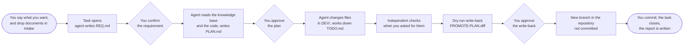

A task of another kind has fewer steps: a root cause analysis or a design ends in a document (`RCA.md`, `DESIGN.md`), with no plan and no write-back. A test task has a guide and a step for each environment: you run it, bring the results back, and the agent judges them.

You can put any task aside (pause), take it up again (resume), or let the agent work down `TODO.md` without stopping to ask (autorun, beta). A closed task can be opened again, or archived out of the repository.

## 4. Follow and steer it in the browser

Run `harness task board` in your own terminal. Your browser opens on the board of every task. It opens as a **lobby**: each open task is a small agent on the floor, in the zone of what it is doing (at work, waiting for you, resting). Point at one: a card shows the task, what it waits for, its stages and its checks, and the same buttons as the list.

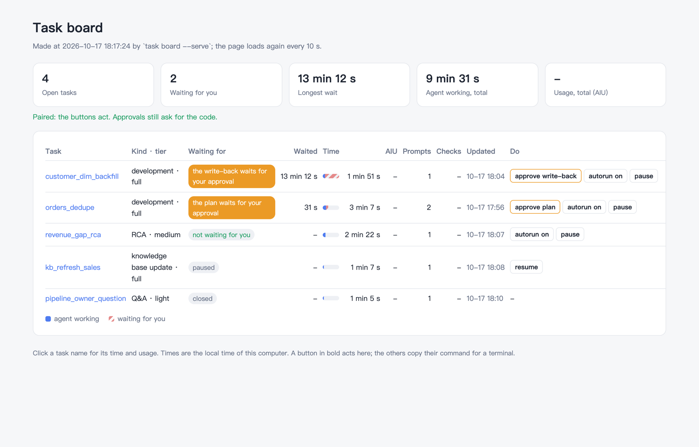

The switch at the top right changes to the list: one line per task with what it waits for, how long, the time split, the checks, and the buttons. Filter by state or kind, search, sort by any column.

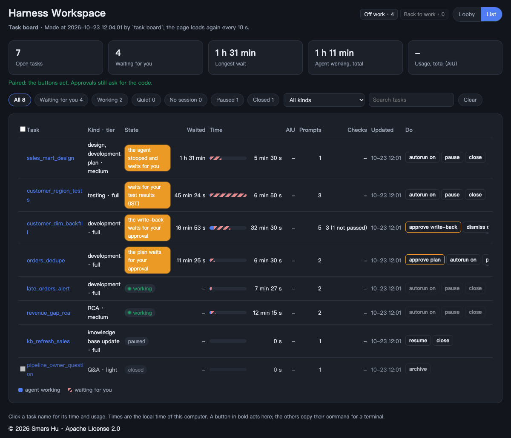

A click on a task opens its page. The page opens with the task's **stages**, which depend on its kind (a test task has one step for each environment). Under them, what waits for you comes first, each button with a line on when to press it. A reviewer row shows the independent checks, and a stamp when all have passed.

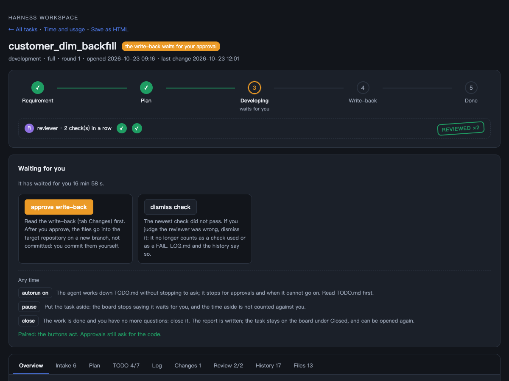

**Intake.** When the requirement came as documents, the **Intake** tab takes them: drop Word, Excel (and PDF) files, or paste a table. A program turns them into Markdown and CSV with no AI and no tokens, and a report says what it left out. You trim the files in a text box, tick the ones to delete, and tell the agent. It reads the small files, never the originals. Details: [Preparing an intake](09-intake.md).

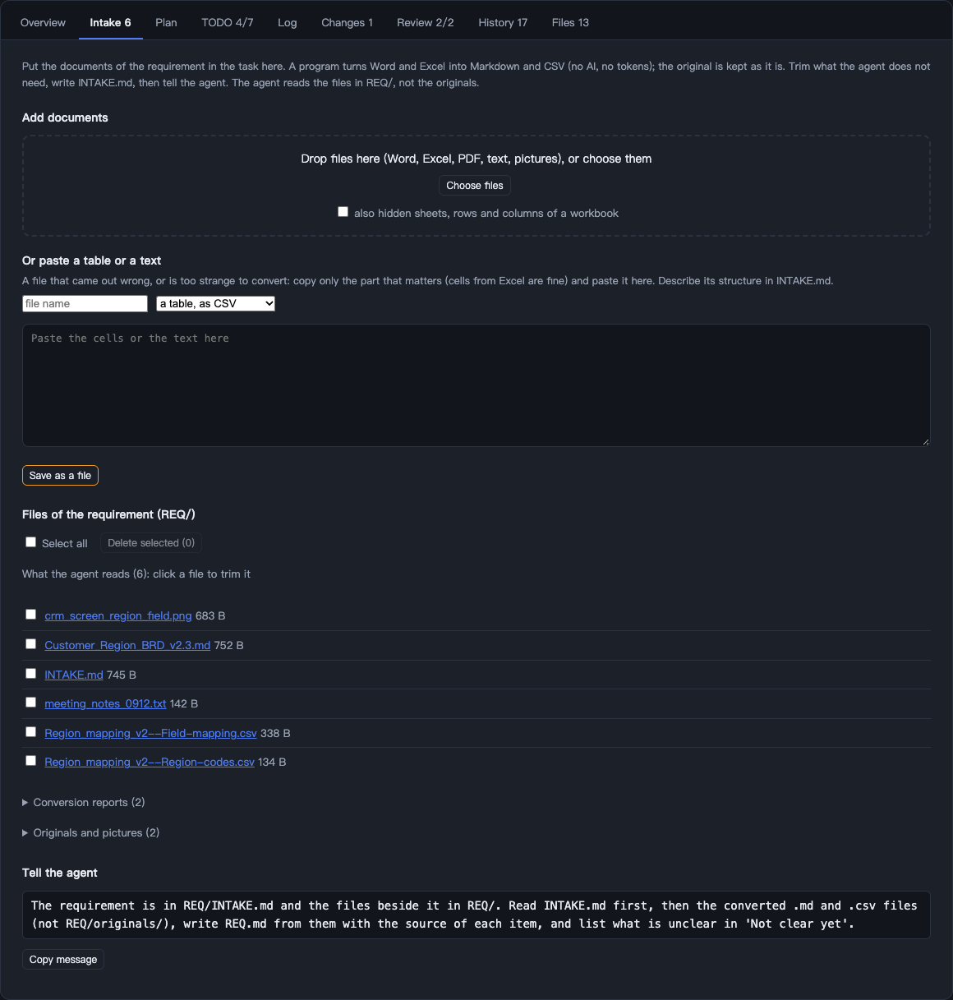

**The plan.** The agent writes the plan as a page: what changes, why, and how it will be checked. Nothing in a repository changes before you approve it.

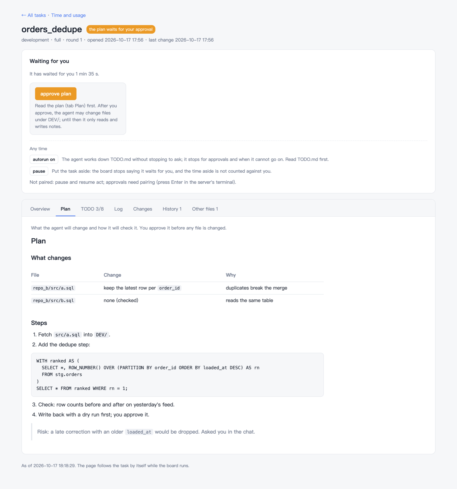

An approval works as in the terminal: the page shows what you approve and asks you to type its code. The agent cannot do this for you.

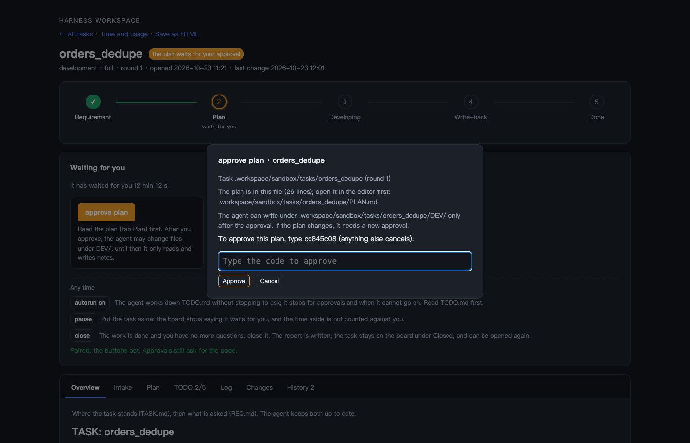

**Progress and changes.** The TODO shows its progress, and the Changes tab shows the files the task changes, the diff (old and new code side by side, as in VS Code, or in one column), and the write-back the last dry run prepared. The write-back goes to a new branch, uncommitted.

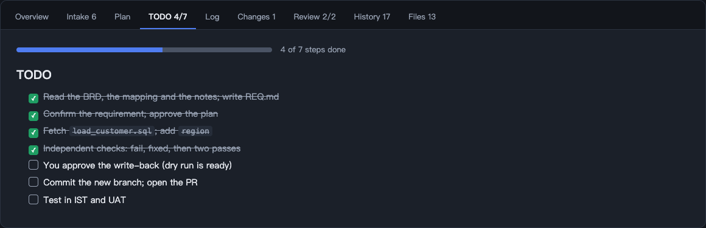

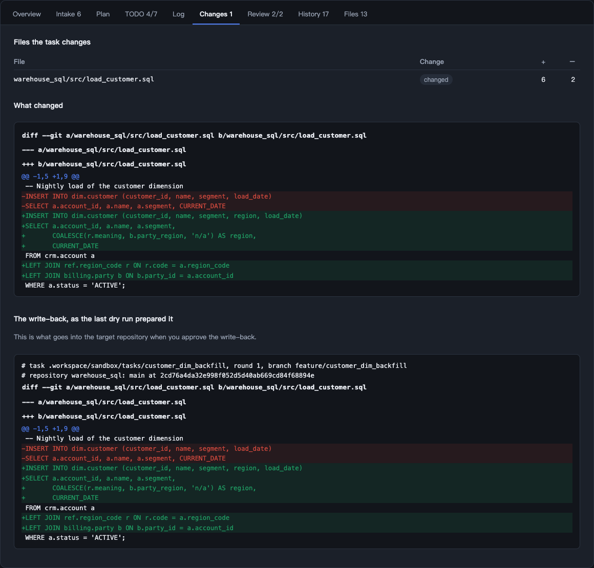

**Independent checks.** With `[review]=n`, the **Review** tab keeps every round: what the reviewer was given, what it found, and its verdict. A check that fails sends the agent back to fix; the checks must pass in a row on the same version.

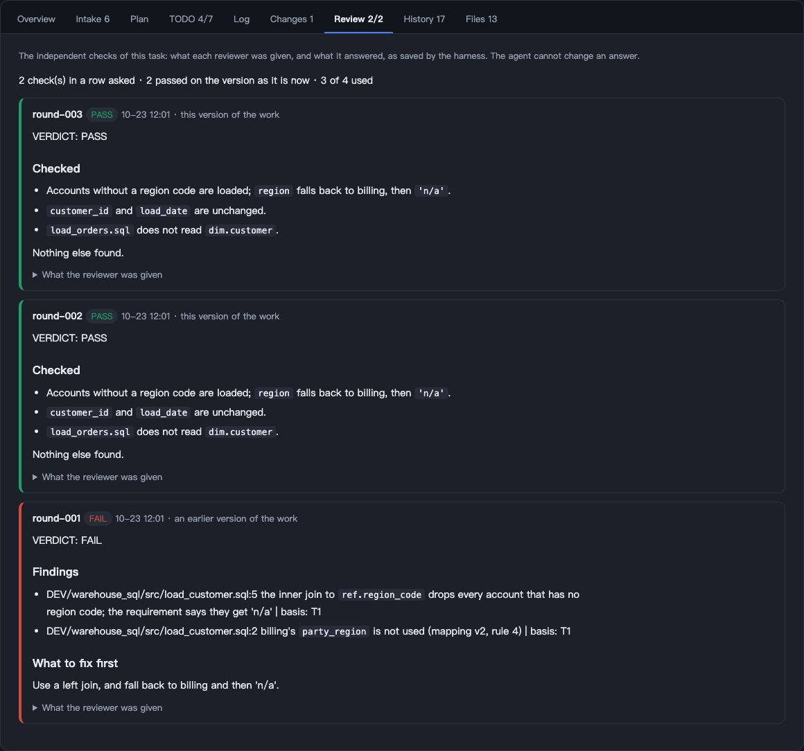

**Testing.** A test task has one guide with a section for each environment. You run the steps, give the output and screenshots on the page (or in the chat), and the agent records each run with a verdict for each criterion. Every run stays: what was run, your words, the pictures, the judgement.

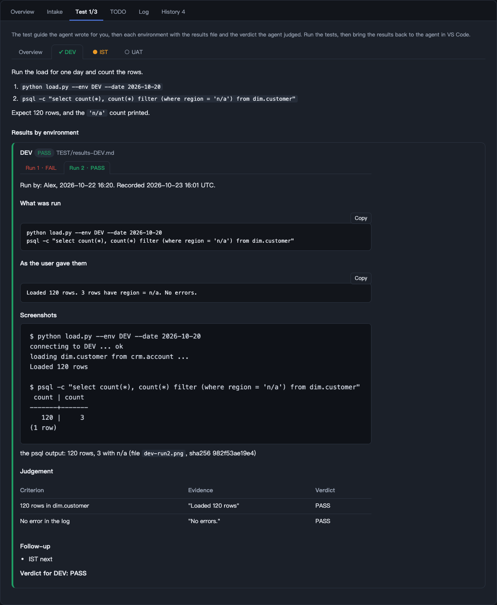

**History.** The history of the task keeps what happened, newest first: documents added, approvals, fetches, checks, runs, write-backs, pauses.

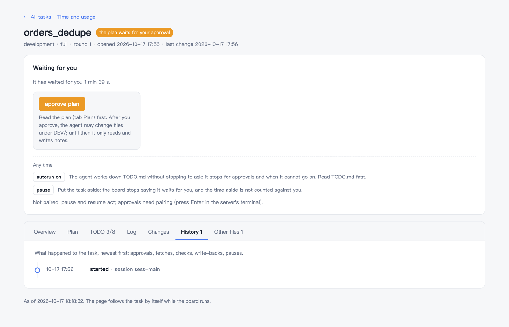

So the work splits cleanly: you talk to the agent and check the code in VS Code; you follow, approve and steer the tasks in the browser. What an agent writes is drawn as text only: nothing in a task file can run on the page. Details: [Features](02-features.md#the-task-page-in-the-browser).

## 5. Where the time went

Every task has an analysis: how long the agent worked, how long it waited for you and on what, every prompt, the stages, the tools, and the usage Copilot records (AIU, premium requests).

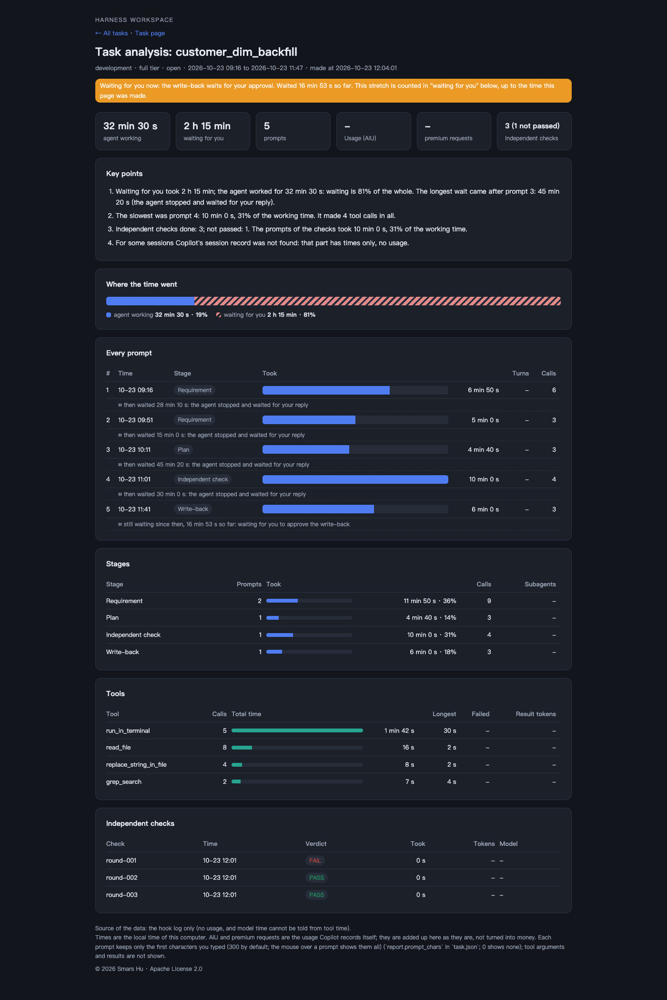

The numbers come from the hook log and Copilot's own session record, not from the agent's word. Details: [Features](02-features.md#observability-logs-statistics-reports-scenario-checks).

## 6. How it is built

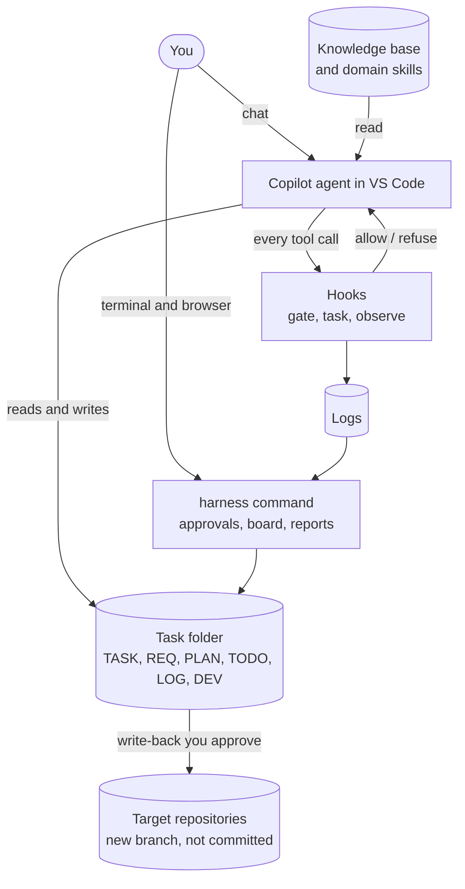

| Part | Who provides it | What it does |
| --- | --- | --- |
| Copilot agent | GitHub | Thinks and calls tools: read, write, search, run commands |
| Knowledge base and domain skills | Your team | What your work and your code look like: definitions, tables, pipelines, steps for a kind of job |
| Harness | This repository | Rules (`AGENTS.md`, instructions), limits (the gate, approvals, independent checks), the task way of working, general skills, logs, the board, reports |
| Targets | Your environment | Code repositories, the knowledge base, and what the agent reaches through tools |

The harness is plain files and Python with no required dependency (two optional packages read old Excel and PDF files): hooks in `.github/hooks/`, rules in `AGENTS.md` and `.github/`, the engine in `.harness/`. Nothing runs outside your computer. Details: [Design](05-design.md).

## 7. The ideas behind it

- **Rules are enforced by code, not asked for in a prompt.** A model can ignore a sentence. It cannot get past a hook that refuses the call. Only the rules that must hold are code; the rest stays in instructions.
- **A person approves what cannot be taken back.** The plan, the write-back, git writes, switching autorun on: each needs a code typed in your terminal or on the board page. The agent cannot approve for you.
- **The checker is not the author.** Independent checks run in a separate reviewer that sees the work and the requirement, not the author's reasoning.
- **Scripts do what has one right answer.** Fetching files, diffs, write-backs, the repository map of the knowledge base, checking its form: code, not the model. That is faster, repeatable, and costs no tokens. See [Cost](06-cost-optimization.md).
- **Reading the knowledge base must cost less than reading the code.** Hence a fixed form for it, one line per object with the version of the source it was learned from, and scripts that find what went stale.
- **Everything is a file.** The task, the plan, the history, the report: you can read, diff and keep them, with or without the harness.

## 8. What is not solved yet

| Area | Where it stands |
| --- | --- |
| Measuring how well the agent works | There are fixed scenarios (`eval`) and per-task reports, but no systematic quality score across tasks yet |
| The knowledge base | The standard form, migration, the repository map and the gaps are built; how much they improve real tasks is being measured |
| Cost and speed | Big tasks still spend many tokens and much waiting; the reports show where, the next step is to cut it |
| Copilot itself | Behaviour inside Copilot is Copilot's. After an upgrade some features may have to follow |

## Getting started

| Step | What to do | Where to read |
| --- | --- | --- |
| 1 | Set up the short command `harness` and run `doctor` | [Quick start](01-quickstart.md) |
| 2 | Register the target repositories | [Configure and customise](03-configure.md) |
| 3 | Plug in the knowledge base and its instructions | [Configure and customise](03-configure.md) |
| 4 | Write domain skills (names start with `domain-`) | [Configure and customise](03-configure.md) |
| 5 | Try it on real tasks, and improve the knowledge base and the skills by the results | [What to say day to day](01-quickstart.md#7-what-to-say-day-to-day) |

The gate checks the text of commands. **It guards against mistakes, not against someone set on getting around it.** Do not treat it as a sandbox.
