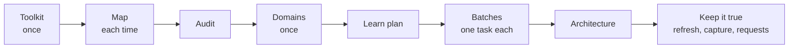

# The knowledge base: built from the code, kept true

For a team that wants its agent to know its code base: how the harness helps you build a knowledge base from the code, how you can tell it is right, and what you can change for your own code. How to plug a finished knowledge base in is in [Configuration](03-configure.md#knowledge-base); every command is in the [Reference](04-reference.md).

**The quickest way**: type `/harness-rookie-new-knowledgebase` (or say "build our knowledge base"). The agent checks where you stand (`harness kb status`), explains each step in plain words, asks only for what you know, and leads you through the skills below. You can stop at any step and come back with "continue the knowledge base". This page is for when you want to know what happens underneath, or change it.

## The idea

- **The code is the source of truth.** The knowledge base is an index and a summary of it, read first because it is cheaper. Where the two disagree, the code wins.
- **It is a base, not a finished book.** About 95% of it can come from the code. The rest (what runs in which environment, what failed and why) is added over time, by tasks, RCAs and what people export. So it does not try to be complete on day one. It tries to be **honest**: every card says which commit it was read at, and every gap is written down where the next reader sees it.
- **Scripts do the structure; the model does the meaning.** Which objects exist, who uses what, in what order to learn them, whether a card's relations are right: a script, the same every time, no tokens. What an object is for, its rules, its traps: the model, reading the code.
- **Every step is checked before it lands.** Each step is a task with a plan you approve and a write-back you approve. Scripts check what can be checked: the form, the relations, the cited lines, the flows.
- **The harness never connects to an environment.** What only an environment can tell, a person runs and gives; the agent asks for it in a fixed place.

## What a domain looks like

A reader goes down only as far as the task needs:

```text
knowledge-base/
  README.md                         1. the domains, the glossary
  domains/<domain>/
    architecture.md                 2. purpose, flows, key data, where to start, traps, limits
    domain.yaml                        entry points, boundaries, open questions, the commits it was learned at
    objects/index.jsonl                one line per object: its source and the git sha it was read at
    objects/<type>.md               3. the cards, one file per type (sp.md, jobs.md, tables.md ...)
    environment.md                     facts of one environment, from results a person gave
    requests.md                        what a person must still give
    discovery/                         inputs, not facts: research notes, the learn plan
  toolkit/                             how the map reads your code (below)
<the code>                          4. the source of truth
```

The form is fixed and checked by `harness kb check`: the [standard](../.harness/contracts/kb/README.md).

## The road, step by step



| Step | Say in Copilot | The script | The model | You approve | Result |
| --- | --- | --- | --- | --- | --- |
| 1. Toolkit (once per code base) | "make a map of our repositories" | `kb survey`; `kb map --toolkit` tried until your known uses are all found | designs and writes the extractors for your stack | the design, then the write-back | `toolkit/` in the knowledge base |
| 2. Map (before each use) | none: the agent runs it | `kb map`: every object and every use; only changed files read again | none | none | a cache in `.harness/runtime/kbmap/` |
| 3. Audit | "can I trust the map?" | `kb audit`: a sample, then the score | reads the sample blind | the write-back | `toolkit/audit.md`: recall and precision per type |
| 4. Domains (once) | "which domains does our code have?" | `kb split` | names the groups, merges what is one piece of work | `DOMAINS.md` | the domains in `README.md` |
| 5. Learn plan | "learn the domain X from zero; the entry points are ..." | `kb order`: what the entry points reach, bottom up, in batches | checks the entry points, reads a research note as leads | `LEARN-PLAN.md`, then the empty domain | `discovery/learn-plan.md`, `requests.md` |
| 6. Batches | `/generic-kb-learn-batch X`, once per batch | `kb index`, `kb cardcheck` | reads each object's code, writes its card | the plan and the write-back of each batch | cards |
| 7. Architecture | "write the architecture of X" | `kb flows`, `kb cardcheck` | puts the paths into words | the write-back | `architecture.md`, the entry points of `domain.yaml` |
| 8. Keep it true | none: the agent offers it (and, while the knowledge base is not built, the next step once per session at a stop of a task) | `kb stale`, `kb gaps` | fixes the cards a change touched; drafts what a task taught | each write-back | cards in line with the code |

The skills behind the steps: `generic-kb-toolkit-design`, `/generic-kb-toolkit-build`, `generic-kb-toolkit-audit`, `generic-kb-domains`, `generic-kb-learn-plan`, `/generic-kb-learn-batch`, `generic-kb-learn-synthesize`, `generic-kb-refresh`, `generic-capture-knowledge`. You do not need their names; say what you want, and the agent offers the right one. The two with a `/` run only when you type them.

**Already have a knowledge base?** `generic-kb-migrate` moves a domain into the standard form (`kb migrate`). The shas are set at the commit the old index was written at, so `kb stale` then lists honestly what changed since. From there, step 8.

### What each step decides, and who

- **The toolkit decides what the map can see.** It is code your team owns, in the knowledge base. The harness ships none, only two samples: `.harness/examples/kb-toolkits/sqlserver/` (procedures, SQL Agent jobs, SSIS packages) and `spring/` (a Spring Boot service).
- **You decide the entry points and the boundaries.** `kb split` and a research note propose; the agent asks.
- **The script decides the order.** What an object uses is learned before it, so its card can point at the cards below it instead of reading their code again.
- **One batch per task**: objects of one type, at most 20 and about 1500 lines of code. An object longer than that is a batch of its own and is read in parts.
- **The model decides the words, under checks.** A card's relations line must equal the map's uses (`kb cardcheck`). Each rule cites the lines it is in (`L120-L145`), and the check makes sure they fall inside that object's code.

## How you know the map is right

No map of code is complete, and the harness cannot promise yours is. It can measure it, and say where it is blind.

| Check | When | What it shows | What it cannot show |
| --- | --- | --- | --- |
| Known uses (`toolkit/facts.jsonl`) | every `kb map` | the 5 to 10 uses a person knew are all found | anything beyond those few; uses the map makes up |
| Files (`failed_files`, `empty_files`, `skipped`) | every `kb map` | a file the toolkit could not read, or found nothing in | a use missed inside a file it did read |
| Names (`missing`, `outside`, `unresolved`) | every `kb map`, `kb gaps` | names used but defined nowhere; other systems; names that fit nothing | whether a missing name is deleted code or a misread one: look at a few |
| **Audit** (`kb audit`) | after the toolkit changes, before learning | per type: recall (of the uses in the code, how many the map has) and precision (of the uses in the map, how many are real), with every difference and its line | types or forms not in the sample: take more with `--per-type`, another `--seed` |
| Learning | every batch | a use the code shows and the map lacks is noted and goes back to the toolkit | only what has been learned |

The audit reads a sample **blind**: the agent writes down every use it finds in the code before it looks at the map. Every difference is then looked up again at its line. A misreading is corrected, and only what is left counts against the map. The bar is 0.95 for both, per type. Below it, the differences are the examples the toolkit is fixed with.

**What no map sees**: SQL built at run time (`EXEC(@sql)`), calls driven by a configuration table, a package chosen by a variable, synonyms and linked servers it was not taught. These are marked `dynamic` or `outside`, and become requests, not guesses.

## What the code cannot tell

Two files of each domain hold what only people or environments know:

- **`requests.md`**: one row per thing a person must give, with its kind: `code` (a source in no repository; `kb gaps` says where git had it last), `runtime` (a value of one environment), `history` (something to find in git), `decision`. Each row has a read-only command or query the person can run as it is, and a status: `open`, `answered` (when, by whom, where it went), or `declined` (and it is not asked again). The agent asks at its next stop, never in the middle of work.
- **`environment.md`**: one fact a row (is a job enabled, its schedule, what a rule table holds), with the environment, the date, the object, **the sha of its code that day**, and who gave it. When the code moves on, you can see the fact was seen against older code.

## Versions: as of when

- Every index line holds the git sha of the source file when its card was written. `kb stale` compares it with the base branch now and lists the cards whose code changed; `--diff` shows only the change. `generic-kb-refresh` fixes the lines it touches and stamps the card again.
- Every card says `Level: verified (read in <repo> at <commit>)`.
- `domain.yaml` holds the commit of each repository the domain was learned at.
- A source that was deleted keeps its card only with `source_missing` and level `unknown`, so it does not read like checked knowledge.

## Make it yours

| What | Where | Notes |
| --- | --- | --- |
| What a code object is, what a use is, which types are entry points, which folders are retired, words to ignore in names | `toolkit/toolkit.json` and the extractors, in the knowledge base | The main thing a team changes. Through `/generic-kb-toolkit-build` and a write-back; then audit again |
| The uses everyone knows | `toolkit/facts.jsonl` | Add one whenever a map misses something a person knew |
| How many entry points make an object shared | `shared_min` in `toolkit.json`, or `--shared-min` | Lower it when one domain swallows everything |
| Batch size | `--batch`, `--lines` of `kb order` | Defaults 20 objects, 1500 lines |
| The bar of the audit | `--min` of `kb audit` | Default 0.95 |
| Boundaries of a domain | `--stop` of `kb order`, `boundaries` in `domain.yaml` | Framework code, another team's code |
| How your team writes cards, words, traps it knows | a `domain-<domain>-...` skill in the knowledge base, and the glossary | See [Configuration](03-configure.md#skills) |
| The production list (what runs that no repository has) | a read-only query in `toolkit/inventory/` | A person runs it; `kb gaps --inventory` compares |

Leave the `generic-*` skills and the standard as they are: an upgrade of the harness replaces them. Put what is yours into the knowledge base (the toolkit, domain skills, the glossary), where an upgrade never writes.

## An example: spring-petclinic

The `spring` sample toolkit was built on the open-source spring-petclinic by following steps 1 and 2. The outputs below are from that repository, cut short.

```text
kb map     58 objects from 35 files; facts 6 of 6 found; 0 failed, 0 empty
kb split   domains: owner-pet (OwnerController, PetController, VisitController), vet, welcome, crash
           shared: class:BaseEntity, class:NamedEntity, class:Person
kb order --entry OwnerController --entry PetController --entry VisitController
           batch 1 table       owners, pets, types, visits
           batch 2 entity      PetType, Visit, Pet, Owner
           batch 3 repository  PetTypeRepository, OwnerRepository
           batch 4 controller  OwnerController, PetController, VisitController
kb flows --entry VetController
           controller:VetController -uses-> entity:Vet -maps-> table:vets
           controller:VetController -uses-> repository:VetRepository -reads-> entity:Vet
```

The tables are learned before the entities that map them, and the controllers last, so a controller's card points at the cards below it.

## Questions

**The map misses uses I can see in the code.** Note three examples (file, line, the use). `/generic-kb-toolkit-build` fixes the extractor with them, and `kb audit` measures again. Never add a use to a card by hand: `kb cardcheck` refuses it, and the next object of that form would be missed too.

**We have a research note (from a search over our runbooks).** Give it to `generic-kb-learn-plan`. It is kept as it came, in `discovery/`, and used for leads: entry points to check, claims to look for in the map. Only the code makes a card `verified`.

**Learning stopped halfway.** Start `/generic-kb-learn-batch` again in a new task. The next batch is the first one `kb order` gives once what is learned is left out.

**A long procedure (thousands of lines).** It is a batch of its own. The agent reads it in parts, cites lines for every rule, and its card may be longer (one line per 10 of code).

**The code changed after we learned it.** The agent sees it: `task fetch` marks stale cards, `kb stale` lists them, `generic-kb-refresh` fixes them from the diff.

**How much does it cost?** The map, the order, the checks: scripts, no tokens. The tokens go into reading code once per object, and into the cards. See [Cost](06-cost-optimization.md).
